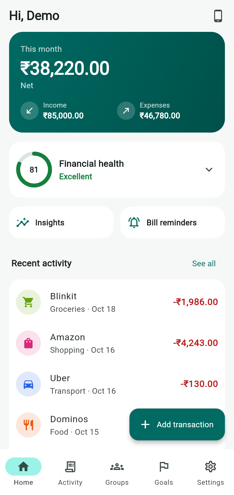
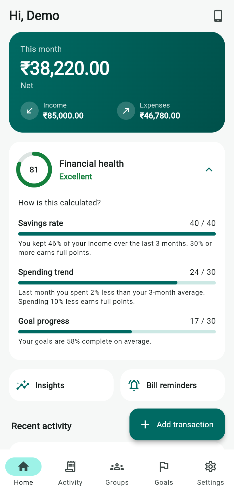
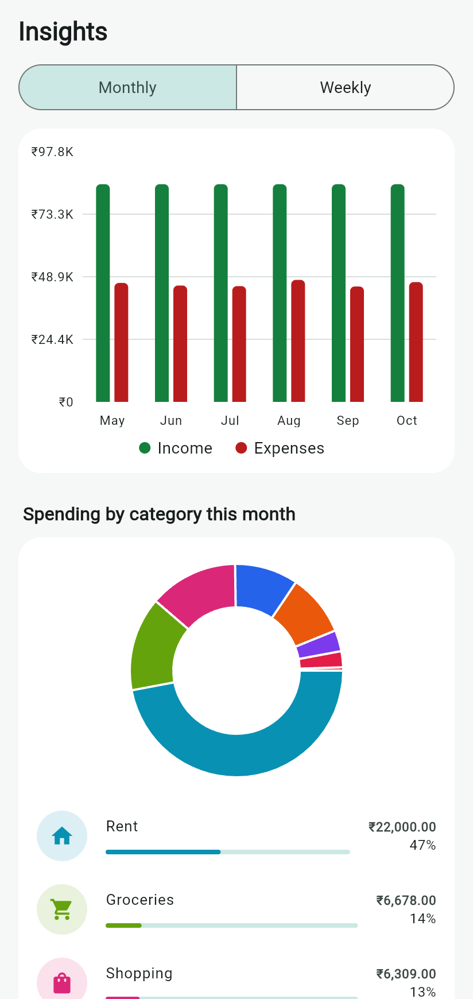
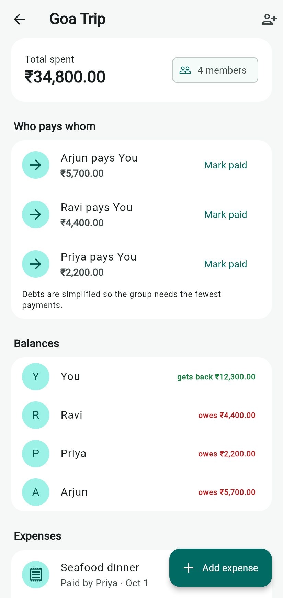
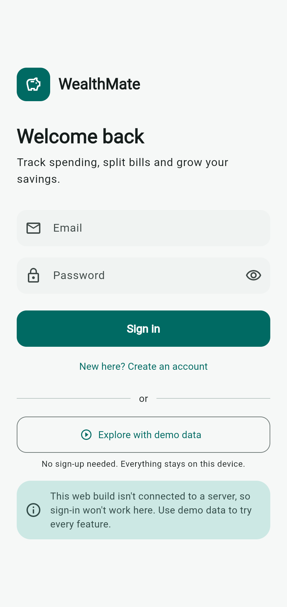
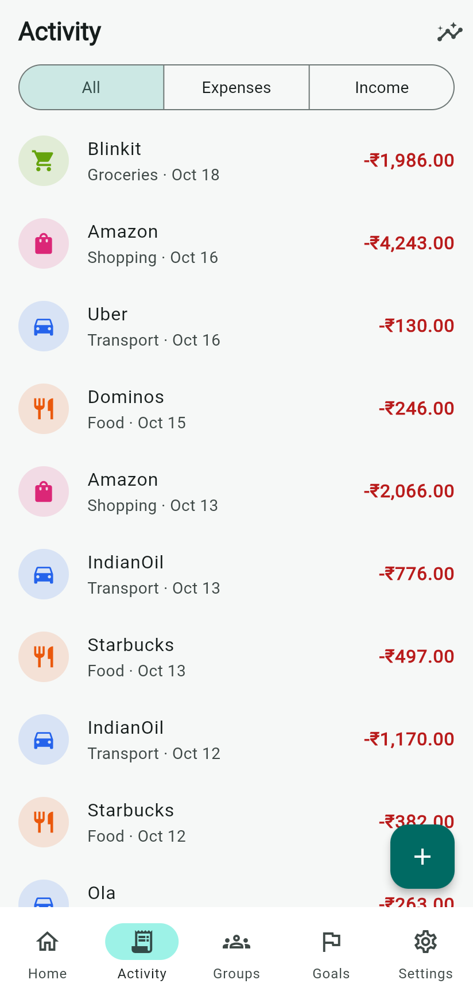
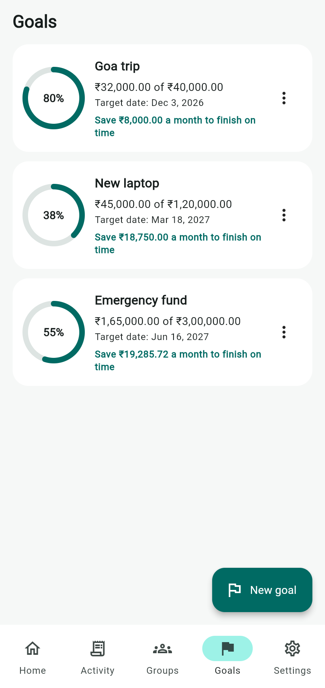
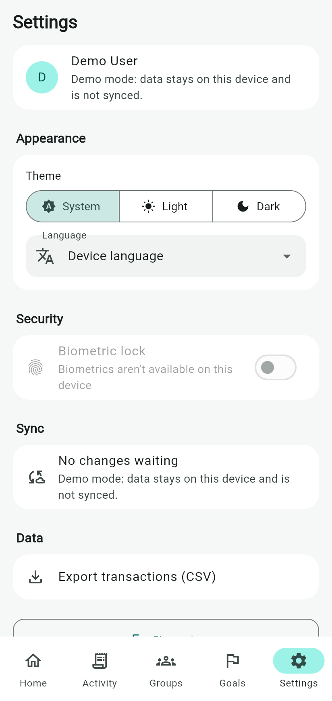
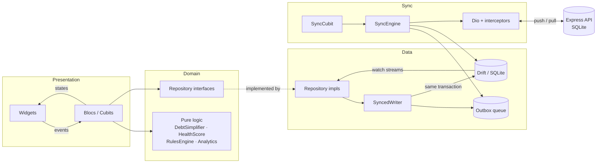

# WealthMate

[](https://github.com/Saipavanavsp/WealthMate/actions/workflows/ci.yml)
[](https://github.com/Saipavanavsp/WealthMate/actions/workflows/deploy-web.yml)

An offline-first personal finance and group expense app built with Flutter, BLoC and a Node.js API.
It tracks income and spending, splits shared bills with the fewest possible settlements, tracks
savings goals, and scores your financial health from 0 to 100.

**Live demo:** https://saipavanavsp.github.io/WealthMate/ (tap *Explore with demo data*, no sign-up needed)
**Android APK:** download `wealthmate-apk` from the latest [Android APK workflow run](https://github.com/Saipavanavsp/WealthMate/actions/workflows/android.yml), or from [Releases](https://github.com/Saipavanavsp/WealthMate/releases)

| Dashboard | Health score | Insights | Settle up |
|---|---|---|---|
|  |  |  |  |

| Sign in | Activity | Goals | Settings |
|---|---|---|---|
|  |  |  |  |

## Features

- **Auth:** email and password with JWT access and refresh tokens, tokens kept in secure storage,
  optional biometric lock, and an offline demo mode.
- **Income and expenses:** categories, notes, dates and weekly or monthly recurring entries, with
  monthly and weekly charts and a category breakdown.
- **Auto-categorisation:** a rules engine guesses the category from the merchant name ("Swiggy" →
  Food) and learns from your corrections.
- **Savings goals:** progress rings and a suggested monthly contribution to finish on time.
- **Group expenses:** split equally or by shares, then a debt-simplification algorithm shows the
  minimum "who pays whom".
- **Financial health score:** 0–100 from savings rate, spending trend and goal progress, with an
  explanation of each part.
- **Bill reminders:** monthly local notifications. A Workmanager background job adds recurring
  transactions when they come due.
- **Settings:** dark mode, English, Telugu and Hindi, accessibility labels, CSV export.
- **Offline-first sync:** everything works without a network, and changes sync when you are back online.

## Tech stack

| | |
|---|---|
| App | Flutter 3.47, Dart 3.13, null safety, Material 3 |
| State | flutter_bloc (Bloc for event-driven flows, Cubit for simple ones), equatable, sealed classes |
| DI / routing | get_it, go_router (stateful shell with bottom navigation) |
| Local data | Drift (SQLite, WASM on the web) as the single source of truth |
| Network | Dio with auth-refresh, retry-with-backoff and logging interceptors, connectivity_plus |
| Platform | local_auth, flutter_local_notifications, workmanager, flutter_secure_storage, share_plus |
| Charts | fl_chart |
| Backend | Node 24, Express 5, TypeScript, `node:sqlite`, zod, JWT, OpenAPI / Swagger UI |
| Testing | flutter_test, bloc_test, mocktail, integration_test, vitest, supertest |
| CI/CD | GitHub Actions: analyze and test, web deploy to GitHub Pages, APK build |

## Architecture

Feature-first clean architecture. Each feature has `domain/` (entities, repository interfaces and
pure logic, with no Flutter imports), `data/` (Drift and API implementations) and `presentation/`
(blocs and widgets).



The UI never waits on the network. Blocs subscribe to Drift `watch()` streams, so a local write, or a
row arriving from the server, updates every screen that shows it.

```
WealthMate/
├── app/                       Flutter app
│   ├── lib/
│   │   ├── core/              database, sync, network, money, DI, router, theme
│   │   ├── features/
│   │   │   ├── auth/          data · domain · presentation
│   │   │   ├── transactions/  + categorisation, analytics, recurring
│   │   │   ├── goals/  health_score/  groups/  reminders/  settings/  dashboard/
│   │   └── l10n/              app_en.arb · app_te.arb · app_hi.arb
│   ├── test/                  unit, bloc, widget and flow tests
│   ├── integration_test/      on-device add-expense → sync test
│   └── tool/                  analytics benchmark
├── backend/                   Express + TypeScript API (see backend/README.md)
├── docs/                      performance notes, git workflow, demo script
└── .github/                   CI, Pages deploy, APK build, PR template
```

## Getting started

Requirements: Flutter 3.47+ and Node 22.13+.

```bash
# 1. API (http://localhost:8080, Swagger UI at /docs, seeded demo account)
cd backend
npm install
npm run dev

# 2. App, in another terminal
cd app
flutter pub get
flutter run --dart-define=API_BASE_URL=http://10.0.2.2:8080/api/v1   # Android emulator
# iOS simulator / desktop / Chrome: use http://localhost:8080/api/v1
```

Sign in with `demo@wealthmate.app` / `Demo@1234` to get the seeded server data, or tap
*Explore with demo data* to run with no server at all.

Generated code (Drift and localisations) is committed. After changing tables or ARB files, run:

```bash
dart run build_runner build     # Drift
flutter gen-l10n                # localisations
```

### Tests

```bash
cd app
flutter analyze
flutter test --coverage                      # 125 tests: unit, bloc, widget and an end-to-end flow
flutter test integration_test -d <device>    # same flow on a real device or emulator

cd ../backend
npm test                                     # 16 API and algorithm tests
```

Coverage: **90.5%** of the domain layer and **95.4%** of the bloc/cubit layer.

## Offline-first sync and conflict strategy

1. **Local first.** Every write goes to SQLite. The UI reads only from SQLite.
2. **Outbox.** In the same database transaction, the change is added to `sync_queue`. If the app
   is killed between the two writes, either both happen or neither does.
3. **Coalescing.** The queue has a unique key on `(entity, record_id)`. Editing a record that is
   already queued replaces the payload and bumps a `revision`, but keeps the original queue position.
4. **Push.** `SyncEngine` sends the queue in id order, in batches of 100. Each entry comes back as:
   - `applied`: removed from the queue, unless its `revision` changed while the request was in flight,
     in which case the newer edit stays queued.
   - `conflict`: the server had a newer copy, which is written locally.
   - `rejected`: failed validation. Kept with the error message and retried up to 5 times, then parked,
     so one bad record never blocks the rest.
5. **Pull.** `GET /sync/pull?since=<cursor>` returns every row changed after the cursor, deletions
   included as tombstones. The cursor is a server-side sequence number, not a timestamp, so device
   clock skew can't cause missed changes.
6. **Conflict rule: last-write-wins on `updatedAt`.** The server applies a write only if it is
   strictly newer, and ties go to the server, so all devices converge. On pull, a remote row is
   skipped if the same record has a newer pending local change; that change wins on the next push.
7. **Triggers.** `SyncCubit` syncs when connectivity returns, 2 seconds after the last local
   change (debounced), every 5 minutes, and on pull-to-refresh. Runs are single-flight.

**Why LWW?** Personal finance records are edited by one person, rarely on two devices at once. LWW
is predictable, needs no merge UI, and is easy to reason about. The trade-off is that concurrent
edits to the *same* record keep only the later one. Field-level merging or CRDTs would fix that, at
a cost in complexity this app doesn't need.

## Algorithms and complexity

| Problem | Approach | Time | Space |
|---|---|---|---|
| Debt simplification | Greedy with two max-heaps: repeatedly settle the largest creditor against the largest debtor. Each round clears one person, so at most n − 1 transfers. | O(n log n) | O(n) |
| Group balances | One pass over expenses (and their shares) and settlements | O(e·m + s) | O(m) |
| Chart aggregation | Single pass; each item placed by binary search over precomputed period boundaries (epoch ms) | O(n log b) | O(b) |
| Category breakdown | Hash map of totals, then sort the categories | O(n + c log c) | O(c) |
| Sync queue enqueue | Indexed upsert on `(entity, record_id)` | O(log q) | O(1) |
| Sync queue batch | Index range scan in id order | O(k + log q) | O(k) |
| Auto-categorisation | Chain of rules, first match wins; keywords compiled into one regex per category | O(r) per lookup | O(r) |
| Money split | Largest-remainder allocation, so shares always add up exactly | O(p log p) | O(p) |

The exact minimum number of settlements is NP-hard (it reduces to subset sum). Greedy is optimal or
close to it for real group sizes, and it is what most expense-splitting apps use.

Code: [`debt_simplifier.dart`](app/lib/features/groups/domain/algorithms/debt_simplifier.dart),
[`max_heap.dart`](app/lib/core/collections/max_heap.dart),
[`spending_analytics.dart`](app/lib/features/transactions/domain/analytics/spending_analytics.dart),
[`sync_queue.dart`](app/lib/core/sync/sync_queue.dart),
[`category_rules.dart`](app/lib/features/transactions/domain/categorisation/category_rules.dart).

## Financial health score

| Part | Points | Formula |
|---|---|---|
| Savings rate | 40 | (income − spending) / income over the last 3 full months. 30% or more gets 40; 0% or less gets 0; linear between. |
| Spending trend | 30 | Last month's spending against the average of the 3 months before it. 10% lower or better gets 30; 30% higher or worse gets 0; linear between (holding steady gets 22.5). |
| Goal progress | 30 | Average of saved / target across goals, each capped at 100%. |

Missing data scores neutrally rather than zero: no goals gives 15/30, no history gives 22.5/30. A new
user starts mid-range instead of looking "unhealthy". Bands: 80+ Excellent, 60+ Good, 40+ Fair, below 40
Needs attention. See [`health_score_calculator.dart`](app/lib/features/health_score/domain/health_score_calculator.dart).

## OOP and SOLID in practice

- **Value object:** `Money` is immutable integer paise with currency checks, operators, and `split` /
  `allocate` that never lose a paisa. Doubles are used only for display.
- **Single responsibility:** `SyncQueueStore` only manages the outbox, `SyncEngine` only runs a sync,
  and `SyncCubit` only decides *when* to sync.
- **Open/closed:** the categoriser is a chain of `CategoryRule`s. New strategies (regex, server rules,
  an ML model) are added without editing existing ones. New synced tables only need a `SyncHandler`.
- **Liskov and interface segregation:** small interfaces (`ConnectivityService`, `ReminderNotifier`,
  `BiometricAuthenticator`, `SyncRemoteDataSource`) are swapped for no-op or fake versions on the web
  and in tests without changing behaviour.
- **Dependency inversion:** blocs depend on repository interfaces in `domain/`. `get_it` wires the
  implementations in one place (`core/di/injection.dart`).
- **Typed errors:** repositories return a sealed `Result<T>` (`Ok` / `Err` with a sealed `Failure`),
  so the UI handles every error case in an exhaustive `switch`.

## Performance

A profiling pass found that the first "single-pass" chart aggregation was 26× *slower* than the naive
version, because it created local `DateTime`s per transaction. Switching to epoch-millisecond
boundaries plus binary search made it 435× faster. With 50,000 transactions it now takes 2.1 ms,
down from 923 ms. Details, the benchmark tool and a DevTools checklist are in
[docs/performance.md](docs/performance.md).

Also: `buildWhen` / `BlocSelector` / `context.select` to scope rebuilds, `ListView.builder`, `const`
widgets, indexed queries, and heavy analytics in an isolate via `compute`.

## Release APK

CI builds an APK on every push to `main` (artifact `wealthmate-apk`). Pushing a tag such as `v1.0.0`
attaches it to a GitHub release. To build and sign locally:

```bash
keytool -genkey -v -keystore ~/wealthmate.jks -keyalg RSA -keysize 2048 -validity 10000 -alias wealthmate
```

Create `app/android/key.properties` (git-ignored):

```properties
storePassword=...
keyPassword=...
keyAlias=wealthmate
storeFile=/absolute/path/to/wealthmate.jks
```

```bash
cd app
flutter build apk --release --dart-define=API_BASE_URL=https://your-api/api/v1
```

Without `key.properties`, release builds are signed with the debug key so they can still be installed for testing.

## Git workflow

Conventional Commits, `<type>/<scope>` feature branches merged with `--no-ff`, and a PR template.
CI runs format, analyze and tests for both the app and the API on every push and PR. The branch
names and PR descriptions for each phase are in [docs/git-workflow.md](docs/git-workflow.md).

## Limitations and next steps

- The hosted web demo runs in offline demo mode because no API is deployed with it. Deploy the API
  with `render.yaml` and set the `API_BASE_URL` repository variable to enable sign-in on the web.
- Last-write-wins works per record. Two devices editing the same record at the same time keep only the later edit.
- Group members are names, not linked user accounts, so groups sync only for the owner.
- Single currency (INR) in the UI, although `Money` and the API carry a currency code.
- Notifications and background jobs need Android or iOS. The web build shows reminders without notifying.
- Recurring transactions on iOS run when the app opens. The background task is registered on Android only.

## Author

**Sai Pavan** · [github.com/Saipavanavsp](https://github.com/Saipavanavsp)

Licensed under the [MIT License](LICENSE).
